<!-- Every card is an animated SVG drawn by scripts/render_readme_cards.py and refreshed daily
     by .github/workflows/update-profile-art.yml. Theme: "Rhine Autumn", taken from the profile illustration.
     The snake comes from .github/workflows/main.yml and lives on the `output` branch.
     Spacing is baked into the SVGs, so keep this block free of blank lines and keep the cards in
     a row on one line with no spaces between them. -->

 
 
 
 
<picture><source media="(prefers-color-scheme: dark)" srcset="./cards/title-building-dark.svg" /></picture> 
<a href="https://github.com/Aadip-Thapaliya/OCG-SSM"></a><a href="https://github.com/Aadip-Thapaliya/deepseek-harness-guide"></a> 
<picture><source media="(prefers-color-scheme: dark)" srcset="./cards/title-journey-dark.svg" /></picture> 
 
<picture><source media="(prefers-color-scheme: dark)" srcset="./cards/title-toolbox-dark.svg" /></picture> 
 
<picture><source media="(prefers-color-scheme: dark)" srcset="./cards/title-connect-dark.svg" /></picture> 
<a href="https://portfolio.aadipthapaliya.workers.dev/"></a><a href="https://www.linkedin.com/in/aadipthapaliya/"></a><a href="mailto:aadipthapaliya@gmail.com"></a><a href="./Lebenslauf_von_Aadip_Thapaliya.pdf"></a> 
 

