<!-- Every card is an animated SVG drawn by scripts/render_readme_cards.py and refreshed daily
     by .github/workflows/update-profile-art.yml. Theme: "Rhine Autumn", taken from the profile illustration.
     Spacing is baked into the SVGs, so keep this block free of blank lines and keep the cards in
     a row on one line with no spaces between them. -->

 
 
 
 
<picture><source media="(prefers-color-scheme: dark)" srcset="./cards/title-building-dark.svg" /></picture> 

<a href="https://portfolio.aadipthapaliya.workers.dev/">portfolio</a> &nbsp;/&nbsp; <a href="https://www.linkedin.com/in/aadipthapaliya/">linkedin</a> &nbsp;/&nbsp; <a href="https://github.com/Aadip-Thapaliya?tab=repositories">all repos</a>

---
